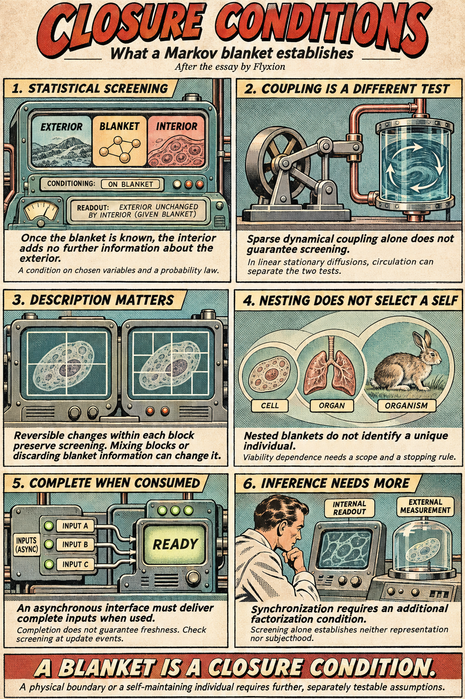
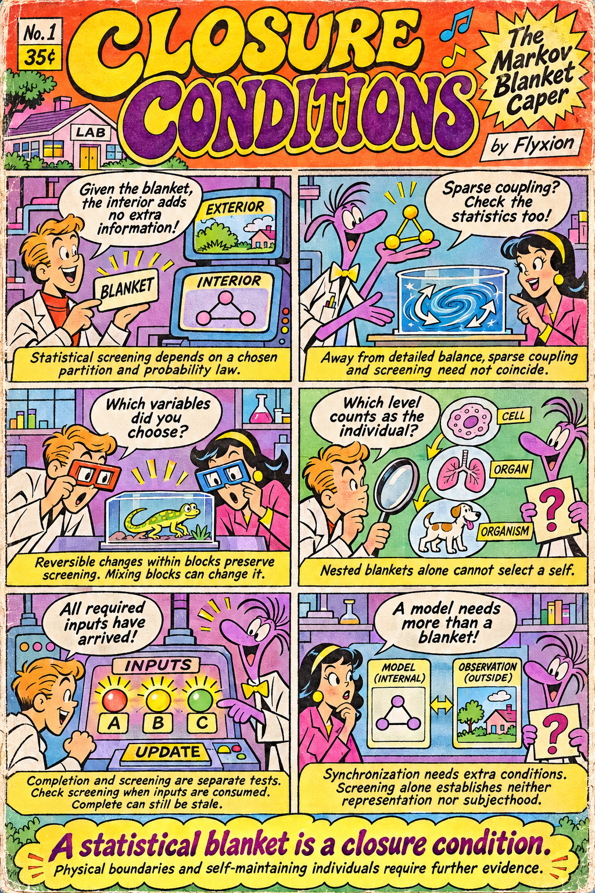
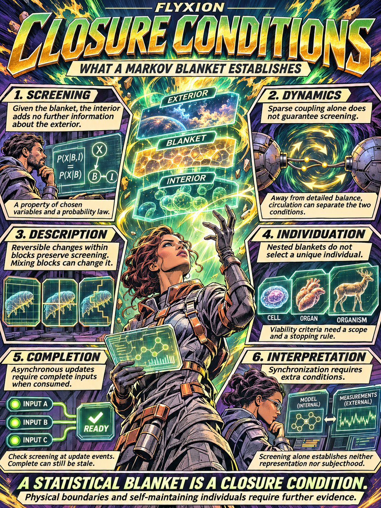
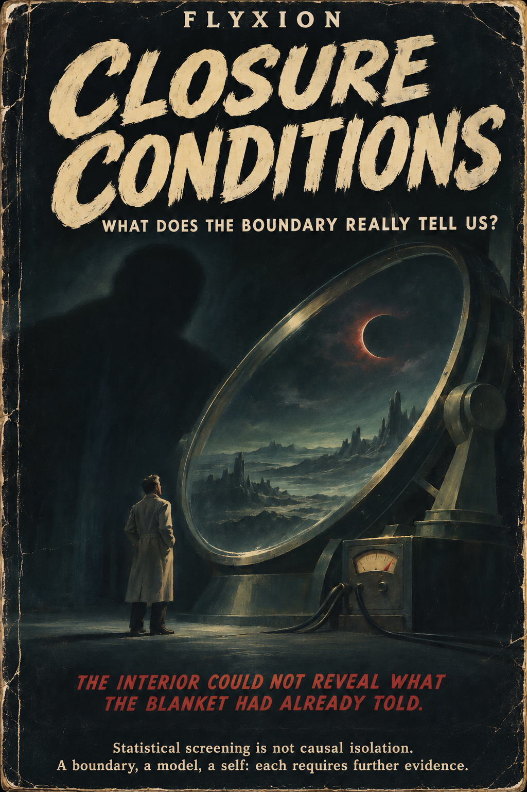
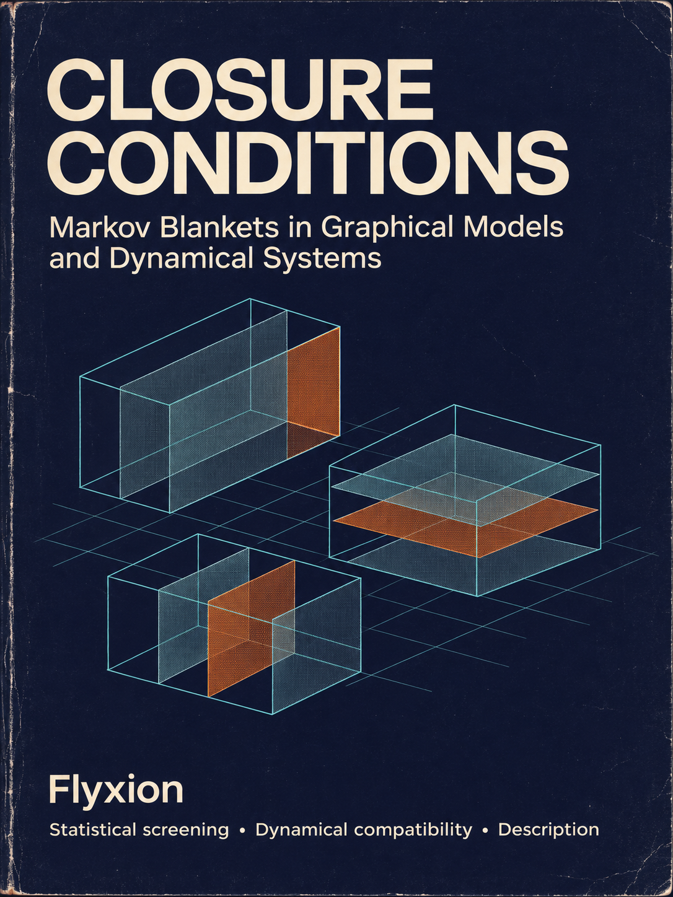

[Closure Conditions on the Description of Bounded Systems](https://standardgalactic.github.io/laboratory/markov-blankets/closure-conditions.pdf)

* [Math Cannot Prove You Are an Individual](https://standardgalactic.github.io/laboratory/markov-blankets/)

<!--

-->
